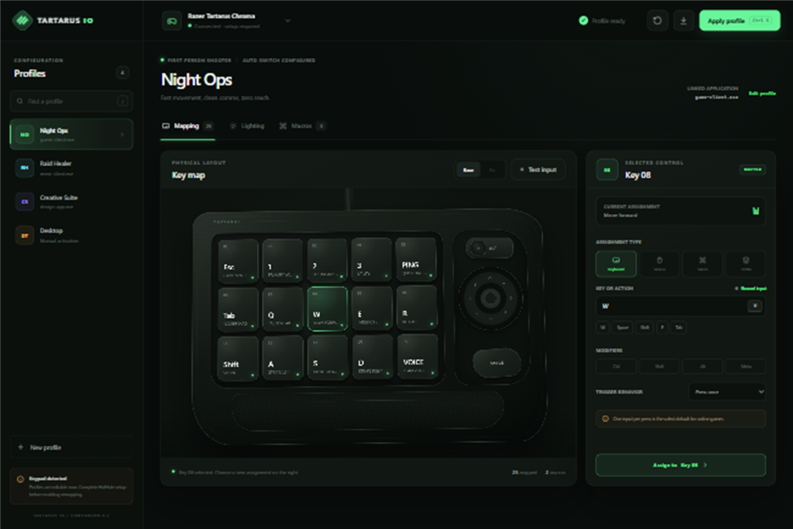
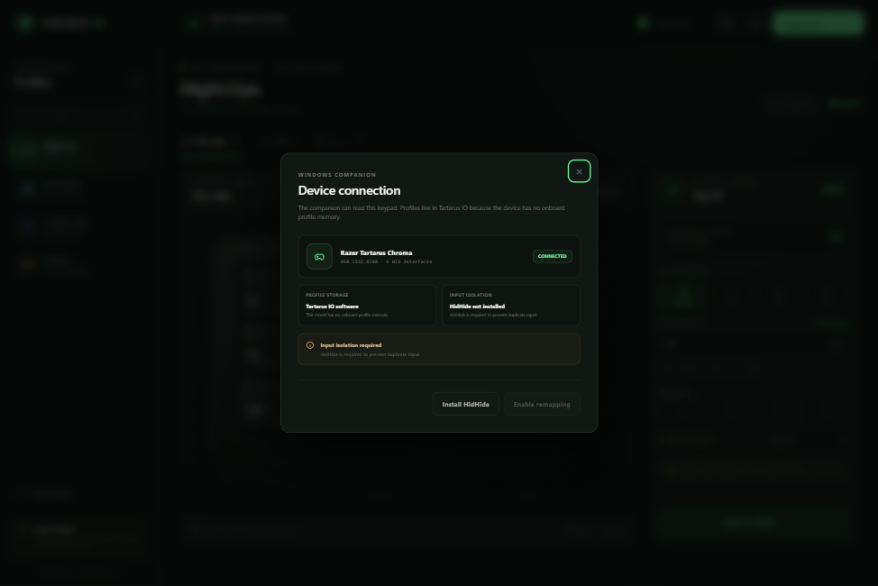
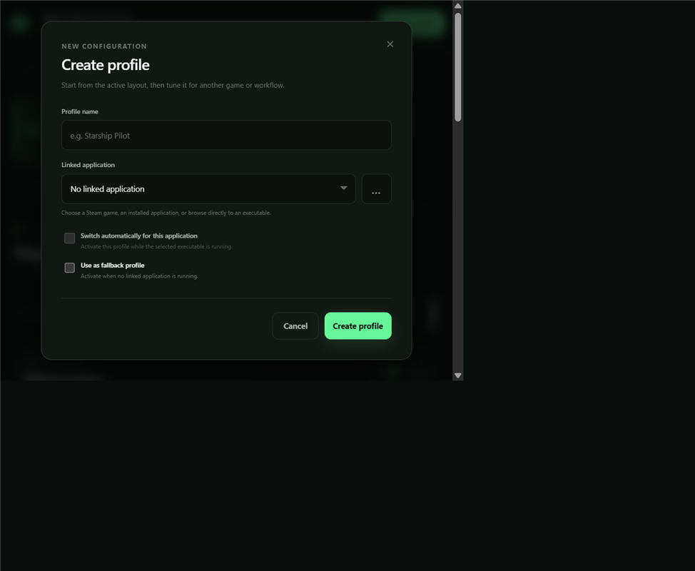
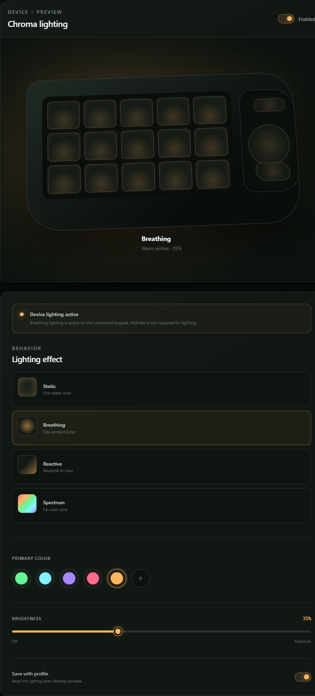
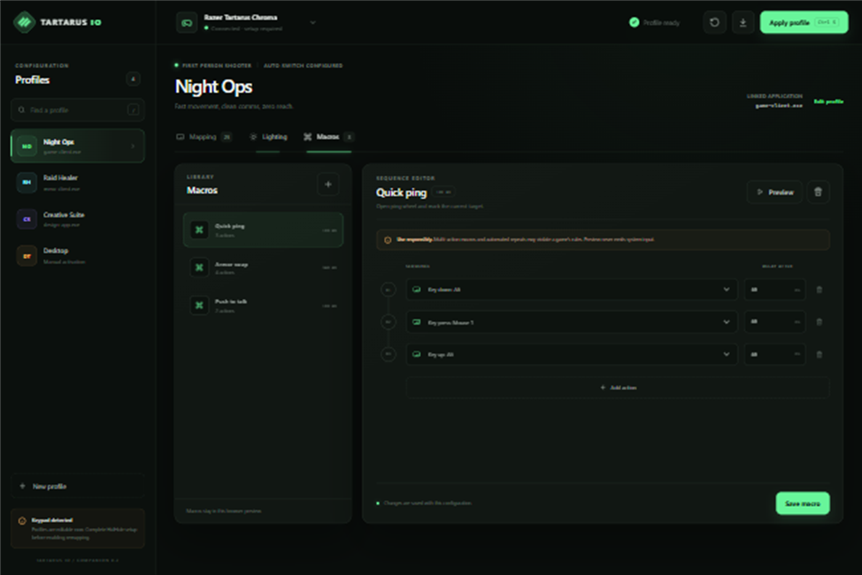

# Tartarus IO

A dependency-free configuration interface and native Windows remapping companion for the original Razer Tartarus Chroma (`RZ07-01510`, USB `1532:0208`).



> [!IMPORTANT]
> The original Tartarus Chroma has no onboard profile memory. There is no device-resident profile for Tartarus IO—or Razer Synapse—to read. Tartarus IO stores profiles in software and applies them while its Windows companion is running.

## Contents

- [Start the interface](#start-the-interface)
- [Connect the keypad](#connect-the-keypad)
- [Manage profiles](#manage-profiles)
- [Map keypad controls](#map-keypad-controls)
- [Configure Chroma lighting](#configure-chroma-lighting)
- [Create and edit macros](#create-and-edit-macros)
- [Save, reset, and export](#save-reset-and-export)
- [Keyboard shortcuts](#keyboard-shortcuts)
- [Data and hardware scope](#data-and-hardware-scope)
- [Troubleshooting](#troubleshooting)

## Start the interface

Tartarus IO supports Windows 10 or 11 x64. No .NET SDK, Node.js installation, or package restore is required.

1. Download or clone this repository.
2. Double-click [`Start-TartarusIO.cmd`](./Start-TartarusIO.cmd).
3. The launcher builds the companion with Windows' included .NET Framework compiler when needed.
4. The companion appears in the notification area and opens `http://127.0.0.1:47651`.

The companion:

- Detects the attached `1532:0208` keypad across its HID interfaces.
- Serves the interface on loopback only.
- Captures input from this keypad through Windows Raw Input.
- Applies profile lighting directly through the keypad's HID lighting interface.
- Stores software profiles and emits mapped keyboard or mouse actions.
- Refuses to enable output until physical input isolation is verified.

Opening [`index.html`](./index.html) directly remains available as a browser-only preview, but it cannot detect or remap the keypad.

## Connect the keypad

### Confirm detection

1. Attach the Tartarus Chroma.
2. Start Tartarus IO.
3. Check the device status in the top bar.
4. Select the status for details.

A connected original Chroma should report:

| Property | Value |
| --- | --- |
| Device | Razer Tartarus Chroma |
| USB identity | `1532:0208` |
| Profile storage | Tartarus IO software |



### Install input isolation

Tartarus IO uses [HidHide](https://github.com/nefarius/HidHide/releases/latest) to keep the keypad's factory keystroke from reaching applications alongside its remapped action.

1. Open **Device connection** from the top bar.
2. Select **Install HidHide** to open the official release page.
3. Install HidHide and reboot Windows if prompted.
4. Start Tartarus IO again.
5. Open **Device connection** and select **Configure HidHide**.
6. Approve the Windows administrator prompt.
7. Unplug and reconnect the keypad.
8. Select **Apply profile** to enable remapping.

Tartarus IO will not emit mapped actions before HidHide is installed, the companion is allow-listed, the Chroma is hidden, and the cloak is active. This fail-safe avoids double input.

HidHide is only required for key remapping. Device detection, profile editing, automatic profile switching, and Chroma lighting work without it.

> [!WARNING]
> HidHide is a kernel filter driver. Download it only from the official `nefarius/HidHide` GitHub releases. To recover from an incorrect configuration, open **HidHide Configuration Client** and turn off **Enable device hiding**, then reconnect the keypad.

## Manage profiles

Profiles keep mappings and lighting settings together for a game or application.

### Select or find a profile

- Select a profile in the left sidebar to open it for editing.
- The profile currently applied by the companion is marked **Active** in the sidebar.
- Use **Find a profile** to filter by profile name, category, or linked application.
- Press `/` when an input is not focused to jump to profile search.
- The open profile's name, category, linked application, and switching role appear above the workspace.

### Create a profile

1. Select the profile whose layout you want to copy.
2. Select **New profile**.
3. Enter a profile name.
4. Choose a Steam game or installed application from **Linked application**.
5. If the application is not listed, select **…** and choose its `.exe` file.
6. Enable automatic switching for linked applications as needed.
7. Optionally make the new profile the fallback.
8. Select **Create profile**.



The new profile starts with a copy of the open profile's mappings and lighting.

### Link applications and choose a fallback

The Windows companion builds the application selector from:

1. Games installed in the detected Steam libraries
2. Applications registered with Windows
3. Any executable selected with **…**

Steam games appear first. If Tartarus IO finds a Steam installation but cannot identify that game's main executable, select the game and use **…** to choose the executable from its install folder.

Exactly one profile is the fallback. It activates on startup and whenever no automatically linked application is running. If multiple linked applications are running, the one started most recently wins. Selecting **Apply profile** creates a manual override until a linked application takes over; after that linked application exits, Tartarus IO returns to the fallback.

### Edit a profile

Select **Edit profile** beside the linked application to change the open profile's name, application link, automatic-switching behavior, or fallback role. To replace the current fallback, edit another profile and enable **Use as fallback profile**.

## Map keypad controls

The **Mapping** workspace represents all 25 programmable inputs:

- 15 finger keys
- 8 thumbpad directions
- Hyperesponse upper thumb key
- Thumb paddle


### Assign a control

1. Select a key, thumbpad direction, upper thumb key, or thumb paddle on the keypad.
2. Choose an assignment type in the right-hand inspector.
3. Enter or select the key or action.
4. Add keyboard modifiers when needed.
5. Choose the trigger behavior.
6. Select **Assign to _control_**.

| Assignment type | Use it for |
| --- | --- |
| **Keyboard** | A key, shortcut, or modified key combination |
| **Mouse** | Mouse buttons and wheel actions |
| **Macro** | A saved sequence from the macro library |
| **Profile** | Switching to another keypad profile |

### Record a keyboard input

1. Select **Record input**.
2. Press the desired keyboard key or key combination.
3. Review the captured key and modifiers.
4. Select **Assign to _control_**.

### Trigger behaviors

| Behavior | Result |
| --- | --- |
| **Press once** | Sends one action for one press |
| **Hold while pressed** | Keeps the action active while the control is held |
| **Toggle on / off** | Alternates between active and inactive |
| **Repeat while held** | Repeats the action until the control is released |

> [!CAUTION]
> Toggle, repeat, and multi-action macro behavior may violate the rules of online or competitive games. Check the applicable game's policy before using automation.

### Test the layout

Select **Test input**, then press controls on the physical keypad. The matching visual control animates and its assignment appears below the device. Before HidHide setup, the keypad's factory input can still reach Windows. Disable active remapping before using Test Input when you want a non-emitting check.

## Configure Chroma lighting

Open the **Lighting** workspace to control the connected keypad and preview profile-specific RGB settings.



1. Use **Enabled** to turn the keypad lighting on or off.
2. Choose an effect:
   - **Static** — one steady color
   - **Breathing** — a slow ambient pulse
   - **Reactive** — lights briefly when the keypad receives input
   - **Spectrum** — a continuous full-color cycle
3. Select a preset color or use the custom color control.
4. Adjust **Brightness**.
5. Enable **Save with profile** to recall the lighting whenever the profile activates.

The browser preview and physical keypad update after each setting is saved. HidHide is not required for lighting.

The original Tartarus Chroma exposes one hardware lighting zone. Tartarus IO uses the device's native static and breathing modes, and drives reactive and spectrum animations through the companion so that the selected brightness applies consistently. Brightness scales the selected RGB values because this model does not expose a separate supported brightness command.

Lighting commands use temporary device storage and are reapplied when the companion starts, the keypad reconnects, or a profile with **Save with profile** enabled activates. Turning **Save with profile** off keeps the previous device lighting when that profile activates.

## Create and edit macros

Open the **Macros** workspace to manage reusable action sequences.



### Create a macro

1. Select the `+` button in the macro library.
2. Select an action from the first sequence row.
3. Enter the delay after the action in milliseconds.
4. Select **Add action** for each additional step.
5. Select **Save macro**.

### Edit a macro

- Select a macro in the library to open it.
- Change an action with its dropdown.
- Change timing in the **Delay after** field.
- Remove a step with its trash button.
- Select **Preview** to animate the sequence without sending system input.
- Select the macro-level trash button to delete the macro.

To use a macro, return to **Mapping**, select a keypad control, choose **Macro**, and select the macro by name.

> [!WARNING]
> Macro preview is deliberately non-emitting. Assigning a macro to a control and enabling native remapping emits the sequence. Review the rules of the target game before using it.

## Save, reset, and export

Configuration changes are persisted automatically in browser storage and synchronized to the companion.

- **Apply profile** or `Ctrl+S` saves and manually activates the open profile, then enables remapping when device isolation is ready.
- **Reset active profile** restores a bundled profile to its original layout. Custom profiles are retained.
- **Export configuration** downloads all profiles, mappings, lighting settings, and macros as `tartarus-io-config.json`.

## Keyboard shortcuts

| Shortcut | Action |
| --- | --- |
| `/` | Focus profile search |
| `Escape` | Clear and leave profile search |
| `Ctrl+S` | Save and apply the active software profile |

## Data and hardware scope

### Profile save format

The companion stores its authoritative configuration as plain UTF-8 JSON:

```text
%LOCALAPPDATA%\TartarusIO\config.json
```

The current format uses `schemaVersion: 3`. It stores all profiles in one document together with shared macros and editor state:

```json
{
  "schemaVersion": 3,
  "activeProfileId": "desktop",
  "selectedProfileId": "desktop",
  "defaultProfileId": "desktop",
  "profiles": [
    {
      "id": "desktop",
      "name": "Desktop",
      "app": "",
      "appPath": "",
      "appDisplayName": "",
      "autoSwitch": false,
      "mappings": {
        "01": {
          "type": "Keyboard",
          "value": "Tab",
          "description": "Cycle / scoreboard",
          "modifiers": [],
          "trigger": "Press"
        }
      },
      "lighting": {
        "enabled": true,
        "effect": "Breathing",
        "color": "#ffb55f",
        "colorName": "Warm amber",
        "brightness": 35,
        "saveWithProfile": true
      }
    }
  ],
  "macros": []
}
```

| Field | Purpose |
| --- | --- |
| `profiles` | Profile metadata, linked application, mappings, and lighting |
| `activeProfileId` | Profile currently controlling mappings and lighting |
| `selectedProfileId` | Profile currently open in the editor |
| `defaultProfileId` | Fallback profile used when no linked application matches |
| `mappings` | Assignments indexed by keypad control ID |
| `lighting` | Enabled state, effect, `#RRGGBB` color, brightness, and recall behavior |
| `macros` | Shared macro definitions referenced by profile mappings |

Configuration writes are atomic: the companion writes `config.json.tmp` and then replaces `config.json`. The file is not stored in the registry or written to the keypad.

The browser keeps a local mirror under `tartarus-io-state-v2` in `localStorage`. When [`index.html`](./index.html) is opened directly, that browser copy is the only storage; when the companion page is used, `config.json` is authoritative.

**Export configuration** downloads the same schema as `tartarus-io-config.json`. This is the recommended backup method. To restore a configuration manually:

1. Exit Tartarus IO from its notification-area icon.
2. Replace `%LOCALAPPDATA%\TartarusIO\config.json` with the backup.
3. Start Tartarus IO again.

### Other local data

- Companion diagnostics are written to `%LOCALAPPDATA%\TartarusIO\companion.log`.
- The companion captures only Raw Input reports whose device path contains `VID_1532&PID_0208`.
- Mapped keyboard and mouse actions are emitted with the Windows `SendInput` API.
- Lighting is sent independently through non-persistent HID feature reports and does not require HidHide.
- The companion does not write key profiles to the keypad because this model has no onboard profile storage.

## Troubleshooting

### The page says “Browser preview only”

Close the file-based page and start [`Start-TartarusIO.cmd`](./Start-TartarusIO.cmd). Use the page opened at `http://127.0.0.1:47651`.

### The companion is connected but setup is required

Open the device status and complete the HidHide steps under [Install input isolation](#install-input-isolation). Profiles and lighting remain available before driver setup, but active key remapping stays disabled.

### Lighting changes do not reach the keypad

1. Use the loopback page opened by the companion rather than `index.html`.
2. Open **Lighting** and check the device-lighting status above the effect controls.
3. Confirm Windows still reports the connected `1532:0208` device.
4. Exit Razer Synapse, OpenRGB, or another RGB controller that may be writing to the same keypad.
5. Exit Tartarus IO from its notification-area icon and restart it.
6. Check `%LOCALAPPDATA%\TartarusIO\companion.log` for a lighting error.

HidHide setup is not part of lighting troubleshooting.

### The keypad is not detected

1. Confirm Windows Device Manager shows **Razer Tartarus Chroma**.
2. Reconnect the keypad directly instead of through an unpowered hub.
3. Exit Tartarus IO from its notification-area icon and restart it.
4. Check `%LOCALAPPDATA%\TartarusIO\companion.log`.

### Original and mapped actions both fire

Stop remapping immediately. Open HidHide Configuration Client and verify:

- `TartarusIO.Companion.exe` is allow-listed.
- Every `1532:0208` Tartarus Chroma interface is hidden.
- **Enable device hiding** is on.
- **Inverse application cloak** is off.

Reconnect the keypad after changing HidHide settings.

The interaction model was informed by [OpenTartarus](https://github.com/PikkonMG/opentartarus/). The original Chroma lighting report behavior was cross-checked against [OpenRazer](https://github.com/openrazer/openrazer) and [OpenRGB](https://github.com/CalcProgrammer1/OpenRGB). The visual design and implementation are original and specifically model the original 25-input Tartarus Chroma layout.
